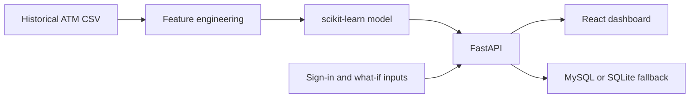

# CashCast: ATM Cash Demand Dashboard

CashCast predicts next-day cash demand for a simulated ATM network and helps cash operations teams review ATM risk, compare forecasts, and plan refills.

> **Demo only:** This project uses historical sample data, not live Bank Muscat systems. The dataset contains 10 ATMs from Indian cities, uses INR, and ends on 2025-08-22. Dispatches are saved as demo records; no cash vans are contacted.

## Start the app

### Windows

Install Python 3.11 or newer and Node.js 22. Docker Desktop is optional. Without MySQL, the API saves demo dispatches and alert acknowledgements to a local SQLite database.

1. Open this project folder.
2. Double-click `run_windows.bat`.
3. Wait for setup to finish. The script creates the Python environment, installs dependencies, creates `.env` if needed, trains the model if its file is missing, and starts the API and website. If Docker is available, it also starts MySQL.
4. Open [http://127.0.0.1:5173](http://127.0.0.1:5173) and sign in with one of the demo accounts below.

Close the two server windows to stop the API and website.

### macOS or Linux

Install Python 3.11 or newer and Node.js 22, then run this from the project folder:

```bash
./run_mac_linux.sh
```

The script starts the API and Vite website. If Docker is installed, it also starts MySQL. Open [http://127.0.0.1:5173](http://127.0.0.1:5173).

### Demo accounts

All accounts use the password `demo123` unless `CASHCAST_DEMO_PASSWORD` is changed in `.env`.

| Role | Email | Access |
|---|---|---|
| Admin | `admin@bankmuscat.demo` | View dashboard, manage settings, and schedule demo dispatches |
| Cash Ops Officer | `ops@bankmuscat.demo` | View dashboard and schedule demo dispatches |
| Viewer | `viewer@bankmuscat.demo` | View dashboard; dispatch is disabled |

Choose the matching role when signing in. These credentials are for local demonstration only.

## Technology stack

| Area | Technology | What it does here |
|---|---|---|
| Dashboard | React 19, JavaScript, Vite, CSS, lucide-react | Renders the dashboard, charts, controls, and icons |
| API | Python 3.11+, FastAPI, Uvicorn, Pydantic, PyJWT | Serves forecasts, validates requests, and handles demo sign-in |
| Data and ML | Pandas, NumPy, scikit-learn, Joblib | Prepares historical features, trains/loads the model, and calculates metrics |
| Persistence | MySQL 8; SQLite fallback | Stores forecasts, demo dispatches, and alert acknowledgements |
| Local deployment | Docker Compose, Nginx | Starts MySQL/API/frontend together and serves the production frontend |
| Cloud template | Amazon ECR, ECS Fargate, RDS MySQL, Secrets Manager | Example production deployment components; resources must be created separately |
| Tests | Pytest, Vitest, Testing Library, GitHub Actions | Checks backend/model behavior and frontend builds/UI |

The frontend does not upload a new dataset. The API reads the checked-in CSV and saved model at startup. The browser sends sign-in, ATM selection, and what-if inputs to the API and displays the returned results.

## Run with Docker

Requires Docker Desktop and Python 3.11+ for the one-time environment setup:

```bash
python make_env.py
docker compose up --build
```

Open [http://127.0.0.1:5173](http://127.0.0.1:5173). Docker Compose starts MySQL, the API, and the frontend. The API image trains the model during the image build, and MySQL data is stored in a named Docker volume. `make_env.py` creates random secrets and will not overwrite an existing `.env`.

## Run services manually

Use this option if you want to run the API and frontend in separate terminals. Python 3.11+ and Node.js 22 are required. MySQL 8 is optional: when it is unavailable, the API automatically uses `data/cashcast.sqlite3` for demo dispatches and alert acknowledgements.

### 1. Prepare Python

From the project root, create and activate a virtual environment, then install the backend and development packages.

PowerShell:

```powershell
py -3.11 -m venv .venv
.\.venv\Scripts\Activate.ps1
python -m pip install -r Backend/requirements-dev.txt
```

macOS/Linux:

```bash
python3 -m venv .venv
source .venv/bin/activate
python -m pip install -r Backend/requirements-dev.txt
```

### 2. Configure the database

Create the local environment file if you want random JWT/MySQL secrets or plan to connect to MySQL:

```bash
python make_env.py
```

The generated `.env` uses port `3307`, the port Docker Compose publishes on your computer. If you use your own local MySQL server, change `MYSQL_PORT` to `3306` and set `MYSQL_HOST`, `MYSQL_DATABASE`, `MYSQL_USER`, and `MYSQL_PASSWORD` to match that server. Create the database and user in MySQL before starting the API. The API creates the CashCast tables when it connects. If MySQL is not configured or cannot be reached, local persistence falls back to `data/cashcast.sqlite3`.

For a local MySQL server, create the database and application user from a MySQL admin account. Replace the password placeholder with the value from `.env`:

```sql
CREATE DATABASE cashcast CHARACTER SET utf8mb4;
CREATE USER 'cashcast'@'localhost' IDENTIFIED BY '<MYSQL_PASSWORD>';
GRANT ALL PRIVILEGES ON cashcast.* TO 'cashcast'@'localhost';
```

To use the Compose MySQL service without Dockerizing the API or frontend, start it from the project root:

```bash
docker compose up -d mysql
```

### 3. Train the model if needed

The supplied model file is ready to use. Retrain it only if you want to regenerate the model and metrics:

```bash
python model/train.py
```

Optional charts can be regenerated with `python model/report.py`.

### 4. Start the API and frontend

In terminal 1, from the project root:

```bash
python -m uvicorn Backend.main:app --host 127.0.0.1 --port 8000
```

In terminal 2:

```bash
cd Frontend
npm ci
npm run dev -- --host 127.0.0.1
```

Open [http://127.0.0.1:5173](http://127.0.0.1:5173). API documentation is available at [http://127.0.0.1:8000/docs](http://127.0.0.1:8000/docs).

## Dashboard features

- **Overview:** network or individual ATM forecasts, cash on hand, model accuracy, and risk.
- **ATMs:** compare cash levels, forecast demand, days of cover, and status across the network.
- **What-if forecast:** estimate demand under holiday, festival, and adjustment scenarios.
- **Replenishment:** review suggested refills and estimate van trips.
- **Alerts:** review cash-risk alerts and acknowledge them when MySQL is available.
- **Settings and profile:** review account details and adjust local display thresholds where the role permits.

The chart selector can display the network or an individual ATM. The forecasts, metrics, alerts, and refill plans come from the FastAPI service.

## How the forecast works

The model is a scikit-learn `HistGradientBoostingRegressor`. It uses past withdrawals and other ATM, calendar, and weather features to estimate next-day cash demand. Training and evaluation use chronological splits; future rows are not shuffled into training.

On the held-out period, the model reports 91.8% accuracy (defined as 100 − MAPE), 8.15% MAPE, ₹48,498 MAE, and an R² of 0.82. The refill replay is a simulation: it compares a fixed 25%-of-capacity rule with a forecast-based rule and assumes a recommended refill arrives before the next day. The reported replay reduced simulated cash-outs from 26 to 0, while using 346 refill trips instead of 302. These are comparison results, not records of real ATM operations.

The replenishment recommendation uses the forecast and ATM capacity to estimate the cash needed. Suggested amounts are capped by the available vault space. Review `Backend/cashcast.py` for the current thresholds and calculation details.

## Input and output



### Model input

The model reads `Dataset/ATM_Cash_Demand.csv`. Each row represents one ATM on one date. The file has 22 columns, including:

- ATM and date: `ATM_ID`, `Date`, `Location`, `City`.
- Cash state and activity: `ATM_Capacity`, `Total_Current_Cash`, withdrawals, deposits, and their counts.
- Context: weekday, temperature, weather, holiday and festival flags, and previous cash level.
- Training target: `Cash_Demand_Next_Day`, the amount the model learns to predict.

`model/features.py` adds previous-day and previous-week withdrawal values, a trailing 7-day average, and next-day calendar/payday features. Training uses rows before 2025-05-01 and evaluates later rows in date order. The model does not use a random train/test split.

### Dashboard inputs

| User action | Input sent to the app |
|---|---|
| Sign in | Email, password, and selected role; sent to `POST /auth/login` |
| Choose an ATM | An ATM ID such as `ATM001`; loads that ATM's history and forecast |
| Run a what-if | `festival`, `holiday`, and `adjust` percentage values; sent to `GET /whatif` |
| Schedule a refill | Selected ATM IDs; saved as a simulated dispatch |

### Results

The model produces a non-negative next-day demand estimate for each ATM. The API combines it with current cash and capacity to return forecast dates, historical predictions, days of cover, risk level, and recommended refill amount. The dashboard also displays network metrics such as accuracy, MAPE, MAE, R², cash on hand, and the simulated cash-out replay.

Example response shape from `GET /forecast/ATM001` (values are from this historical dataset):

```json
{
	"ATM_ID": "ATM001",
	"forecast_date": "2025-08-23",
	"forecast": 727371,
	"source": "historical simulation",
	"simulation": true,
	"items": [
		{ "date": "2025-08-23", "actual": null, "predicted": 727371, "tomorrow": true }
	]
}
```

Model training writes `model/cashcast_model.joblib` and `model/metrics.json`. Forecast and what-if results are returned by the API; dispatch and acknowledgement records are stored in MySQL or the local SQLite fallback.

## API overview

`POST /auth/login` and `GET /health` are public. Other routes require the bearer token returned at sign-in.

| Method | Route | Purpose |
|---|---|---|
| `GET` | `/health` | Model, dataset, and database status |
| `GET` | `/metrics` | Accuracy, error metrics, backtest, and network cash totals |
| `GET` | `/atms` | Per-ATM cash, forecast, cover, risk, and refill recommendation |
| `GET` | `/forecast/network` | Network history and next-day forecast |
| `GET` | `/forecast/{atm_id}` | History and forecast for one ATM, for example `/forecast/ATM001` |
| `GET` | `/whatif` | Forecast with optional `festival`, `holiday`, and `adjust` query values |
| `GET` | `/replenishment` | Refill plan sorted by urgency |
| `GET` | `/alerts` | Current alerts and acknowledgement status |
| `POST` | `/alerts/{id}/acknowledge` | Acknowledge an alert; saved to MySQL or SQLite fallback |
| `POST` | `/dispatch` | Save a simulated dispatch; Admin or Cash Ops Officer only, saved to MySQL or SQLite fallback |
| `GET` | `/dispatches` | Read saved dispatch history |

If MySQL is unavailable, the API uses SQLite if its local data folder is writable. `/health` reports `database: up` when either MySQL or SQLite is available. Dispatch and alert actions only save local simulation records; they never contact an external service.

## Tests and checks

From the project root, with the Python environment activated:

```bash
python -m pytest -q Backend/tests/test_api_behavior.py Backend/tests/test_replenishment.py model/tests/test_features.py
```

The real-MySQL integration suite modifies its configured database, including recreating the `forecasts` table. Run it only against a disposable test database:

```bash
python -m pytest -q Backend/tests/test_mysql_integration.py
```

With the API running, the frontend checks are:

```bash
cd Frontend
npm run lint
npm run build
npm run test:e2e
```

The end-to-end suite signs in to the running API and includes a simulated dispatch test. Use a disposable database when running tests that write MySQL records. GitHub Actions also runs backend checks and frontend lint/build.

## Deploy to AWS

`deploy/ecs-task-definition.json` is a template for the **API container only**. A production setup also needs a frontend host and HTTPS routing. The repository does not create AWS resources.

1. Create an ECR repository for the API, then authenticate Docker and push the image. Replace the placeholders with your AWS account and region:

	```bash
	aws ecr get-login-password --region <REGION> | docker login --username AWS --password-stdin <ACCOUNT_ID>.dkr.ecr.<REGION>.amazonaws.com
	docker build -f Backend/Dockerfile -t cashcast-api:latest .
	docker tag cashcast-api:latest <ACCOUNT_ID>.dkr.ecr.<REGION>.amazonaws.com/cashcast-api:latest
	docker push <ACCOUNT_ID>.dkr.ecr.<REGION>.amazonaws.com/cashcast-api:latest
	```

2. Create a private RDS MySQL 8 database. Allow connections from the API task's security group only. The API creates the tables in `Backend/schema.sql` when it connects.
3. Store `JWT_SECRET`, the MySQL username/password, and `CASHCAST_DEMO_PASSWORD` in AWS Secrets Manager. Give the ECS task execution role permission to read these secrets and write logs.
4. Replace the placeholders in `deploy/ecs-task-definition.json` (image, account, region, RDS endpoint, role ARNs, and secret ARNs). Register the task definition and run it as an ECS Fargate service in private subnets. Expose port 8000 through an HTTPS load balancer and use `/health` as its health check.
5. Build and host the frontend separately, for example in an Nginx container or static hosting. When building for a public API URL, set `VITE_API_URL` to that HTTPS API URL and set the API's `CORS_ORIGINS` to the frontend origin. If using the included Nginx `/api` proxy instead, configure its upstream to resolve to the API service inside the deployed network.
6. Replace demo accounts with a production identity provider before real use. Use MySQL/RDS for persistent records; do not rely on the local SQLite fallback in an ephemeral ECS task.

For AWS CLI task registration, after editing the template:

```bash
aws ecs register-task-definition --cli-input-json file://deploy/ecs-task-definition.json
```

## Project structure

Start in `Backend/main.py` for API startup, `Backend/cashcast.py` for forecast/auth/database routes, `Frontend/src/App.jsx` for the app entry, and `Frontend/src/CashCast.jsx` for the dashboard UI. Model inputs/features and training live under `model/`.

| Path | Contents |
|---|---|
| `Dataset/ATM_Cash_Demand.csv` | Historical input records and next-day training target |
| `model/features.py` | Feature engineering shared by training and API |
| `model/train.py`, `model/cashcast_model.joblib`, `model/metrics.json` | Training script, saved estimator, and evaluation output |
| `model/report.py`, `model/reports/` | Optional charts and walk-forward report |
| `Backend/main.py`, `Backend/cashcast.py` | FastAPI app, auth, forecast, replenishment, and persistence logic |
| `Backend/schema.sql`, `Backend/tests/` | MySQL tables and backend tests |
| `Frontend/src/`, `Frontend/package.json` | React UI, API client, and frontend scripts/tests |
| `Notebook/` | Exploratory analysis and model-training walkthroughs |
| `docker-compose.yml`, `Backend/Dockerfile`, `Frontend/Dockerfile` | Local containers and image build instructions |
| `deploy/ecs-task-definition.json` | ECS/Fargate API task template |
| `make_env.py`, `.env.example` | Local environment and secret setup |
| `run_windows.bat`, `run_mac_linux.sh` | Local setup and launch scripts |

## Notebooks

Open `Notebook/Data_analysis.ipynb` for exploratory analysis or `Notebook/Model_training.ipynb` for the training and evaluation workflow. To run them, install Jupyter; the data-analysis notebook also uses Seaborn. The notebooks import code from `model/`, which is also used by the API.

## Limitations and security

- Data ends on 2025-08-22, so the demo's next-day forecast is for 2025-08-23.
- Demo accounts are stored in the API application, not a production identity provider. The login lockout is in memory and resets when the API restarts.
- The browser stores the demo JWT in `sessionStorage`.
- Do not use the example credentials, demo secrets, or historical data for a production deployment. Configure real secrets, identity, HTTPS, CORS origins, and a production database before deployment.
- `deploy/ecs-task-definition.json` is a template only. The project does not create AWS resources.
